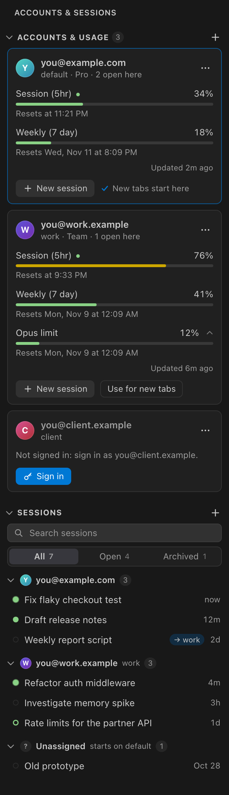

# Many Hats

**Run each Claude Code tab on its own Claude account, side by side in one window.**

Maybe you have a work account and a personal one, or one account per client. Claude Code is signed in to one account at a time. With Many Hats, every tab in the same window can use a different account at once:

- each tab uses its own account's login, plan and usage limits;
- your conversations, settings, `CLAUDE.md`, skills, plugins and memory are shared by all of them.

## What it does

- **A tab per account.** Start a new Claude Code tab on any account, or pick the account new tabs start on.
- **Sessions remember their account.** A conversation reopens on the account it belongs to, whether you restore it after a reload, open it from history or open it in another window.
- **Every account at a glance.** The sidebar shows each account's plan and usage windows (5-hour, weekly, per model), and when each one resets.
- **Your sessions, grouped by account.** Search, open, rename, archive, delete, or move a session to another account.
- **Safe by design.**
  - Many Hats never reads or stores your login tokens. Each account signs in through Claude Code's own `claude auth login`.
  - It makes no network calls and has no telemetry.

## Requirements

- macOS (Apple silicon or Intel).
- An editor based on VS Code: VS Code, Cursor, Windsurf, VSCodium or another.
- The [Claude Code extension](https://marketplace.visualstudio.com/items?itemName=anthropic.claude-code).

## Quick start

1. Install Many Hats. A hat icon appears in the activity bar.
2. In the Many Hats sidebar, click **+** to add an account. Give it a short name (`work`, `client-a`) and, optionally, its email, then **Sign in**. A terminal runs `claude auth login` for that account only; approve in your browser.
3. Click **New session** on an account's card. A Claude Code tab opens on that account.

Your existing Claude Code login is the **default** account. To make new tabs in this window start on another account, use **Use for new tabs** on its card, or click the account name in the status bar.

## How it works

- **A folder per account.** Claude Code keeps one login per config folder. Each extra account gets its own folder in `~/.many-hats/accounts/`, with everything shared from `~/.claude` linked into it.
- **New tabs.** Many Hats sets the account for new tabs in the window's environment, which Claude Code uses when it starts a tab.
- **A small launcher.** Claude Code starts every tab through it (its `claudeCode.claudeProcessWrapper` setting). The launcher starts a resumed session on the account it belongs to.
- **Moving a session.** Moving changes the account its tab starts on next time. A tab that's open keeps running where it is until it restarts.

The details are in [docs/ARCHITECTURE.md](docs/ARCHITECTURE.md).

## Commands

The Command Palette, under "Many Hats":

| Command                                              | What it does                                                                      |
| ---------------------------------------------------- | --------------------------------------------------------------------------------- |
| Choose Account for New Claude Code Tabs              | Picks the account new tabs in this window start on. The status bar opens it too.  |
| Open Claude Code Tab on Account…                     | A new tab on any account, leaving the account for new tabs as it is.              |
| Move Claude Code Tab to Account…                     | The tab's session belongs to that account from now on.                            |
| Add Account… / Sign In to Account… / Remove Account… | Manages your accounts.                                                            |
| Show Claude Code Tabs by Account                     | Which open tab runs on which account.                                             |
| Check and Repair Setup                               | Runs the self-checks and fixes what's safe to fix.                                |
| Collect Diagnostics                                  | Copies a report for a bug report. It contains no emails, tokens or account names. |
| Remove All Accounts and Data…                        | Signs out and removes every extra account, before you uninstall.                  |

## Privacy and security

**What Many Hats never does:**

- read, copy or store a login token;
- connect to the network, or collect telemetry.

**Where everything lives.** All of Many Hats' data is in `~/.many-hats`, readable only by you.

**Desktop-app sessions.** A token passed down from the Claude desktop app would override the account. The launcher removes it from the environment of the tabs it starts, so every tab runs on its own account's login.

To report a vulnerability, see [SECURITY.md](SECURITY.md).

## Uninstalling

**To remove everything first,** run **Many Hats: Remove All Accounts and Data…**, then uninstall. This signs out the extra accounts, removes `~/.many-hats` and points Claude Code back at its own start-up. Your default login, conversations and settings in `~/.claude` stay.

**If you just uninstall,** Many Hats removes its process-wrapper setting from that editor. Your accounts stay in `~/.many-hats`, so reinstalling picks up where you left off.

## FAQ

**Does Many Hats give me more usage?**

- No. Each account has its own plan and limits, exactly as if you signed in to it alone.
- Many Hats is for keeping accounts apart, such as work, clients and personal.
- Use your accounts within [Anthropic's terms](https://www.anthropic.com/legal).

**Which account does a session belong to?**

- The account it was first seen running on, until you move it.
- Sessions Many Hats hasn't seen running yet are listed under **Unassigned**. Opening one starts it on the account for new tabs.

**Why only macOS?**

- Many Hats reads process environments and keeps logins in the macOS Keychain.
- A Linux port needs only one small adapter (`src/platform`). Contributions are welcome.

**What if a Claude Code update changes something Many Hats relies on?**

- Many Hats checks what it reads. If a format changes, the affected feature pauses, shows a notice, and never acts on data it can't read.
- A nightly check against the latest Claude Code release also catches these changes.

**Does it work with the Claude desktop app?**

- Sessions started by the desktop app run on the desktop app's login. They show in the sidebar once you open them in an editor tab.

## Limitations

- Claude Code's own panel can't show which account a tab is on; the sidebar and the status bar do.
- Claude Code's account display, sign-in screen and Logout command follow the account for new tabs, not the tab you're looking at.
- The sidebar keeps its own archive: Claude Code's archive is private to it.

## Contributing

Issues and pull requests are welcome. See [CONTRIBUTING.md](CONTRIBUTING.md).

## License and trademarks

[MIT](LICENSE). Claude and Claude Code are trademarks of Anthropic, PBC. Many Hats is an independent project, not affiliated with or endorsed by Anthropic.
